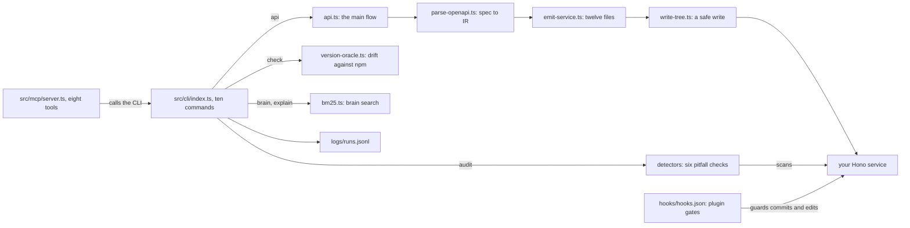

# How Turbo works

Turbo is a backend specialist for TypeScript services built on Hono, a small web framework. Give it an OpenAPI file, the standard way to describe an HTTP API, and it writes a typed service. It also audits existing services for known backend bugs. It checks its own pinned package versions against npm. A coding agent can drive every command, because each one takes `--json` and never stops to ask a question. It is for developers and agents who want a new service that starts out correct.

## The parts

[src/cli/index.ts](../src/cli/index.ts) is the command line, or CLI, with ten commands: `api`, `scaffold`, `audit`, `check`, `brain`, `explain`, `stream-doctor`, `contract`, `migrate-plan` and `eval`. Their code lives in [src/cli/commands/](../src/cli/commands/). `api` is the main flow, in [src/cli/commands/api.ts](../src/cli/commands/api.ts). [src/generator/parse-openapi.ts](../src/generator/parse-openapi.ts) validates the spec and turns it into an IR (intermediate representation), a plain list of routes and schemas. [src/generator/emit-service.ts](../src/generator/emit-service.ts) turns the IR into the files of a Hono service, using the templates in [src/generator/templates.ts](../src/generator/templates.ts). [src/generator/write-tree.ts](../src/generator/write-tree.ts) writes them to disk. `scaffold` runs the same emitter on one built-in example resource, so it needs no spec.

[src/audit/detectors/index.ts](../src/audit/detectors/index.ts) holds six detectors, each tied to a pitfall in [brain/KNOWN-PITFALLS.md](../brain/KNOWN-PITFALLS.md). Two catch data bugs: state shared between requests, and a defaulted schema reused for a PATCH update. Three catch a missing type-check step, streaming traps and a client that loses its types. The sixth flags CORS, the browser's cross-site rule, when it allows any site with credentials. [src/audit/version-oracle.ts](../src/audit/version-oracle.ts) compares the versions pinned in [brain/TOOL-MATRIX.md](../brain/TOOL-MATRIX.md) with npm. [src/memory/bm25.ts](../src/memory/bm25.ts) ranks sections of six brain files with BM25, a standard keyword-ranking formula. [src/mcp/server.ts](../src/mcp/server.ts) is an MCP server: MCP (Model Context Protocol) is the standard way coding agents call outside tools. Each of its eight tools, listed in [src/mcp/tools.ts](../src/mcp/tools.ts), runs the CLI with `--json`. [src/obs/run-logger.ts](../src/obs/run-logger.ts) appends one line per run to `logs/runs.jsonl`. [web/server.mjs](../web/server.mjs) serves the cockpit, a local page with the brain, the run log and the eval results. The plugin hooks in [hooks/hooks.json](../hooks/hooks.json) check an agent's own commits and file edits.

## What happens when you run it

1. `turbo api --spec eval/fixtures/petstore.openapi.json --out ./service` goes from [src/cli/index.ts](../src/cli/index.ts) to `runApi` in [src/cli/commands/api.ts](../src/cli/commands/api.ts). With `--runtime workers` it stops here with an error, because only a Node entry is built.
2. `parseOpenApi` in [src/generator/parse-openapi.ts](../src/generator/parse-openapi.ts) validates the spec and resolves its `$ref` links with `@apidevtools/swagger-parser`. It then walks each path into the IR, whose types live in [src/generator/ir.ts](../src/generator/ir.ts). A spec that fails validation stops the run with exit code 1.
3. `emitService` in [src/generator/emit-service.ts](../src/generator/emit-service.ts) builds twelve files in memory. They hold the routes, their schemas, a typed client, `/health`, `/openapi.json` with a docs page, and a contract test. The routes check path parameters and JSON bodies with Zod, a schema library.
4. For a PATCH update, [src/generator/emit-zod.ts](../src/generator/emit-zod.ts) writes the request schema without `.default()` values. So an update cannot reset the fields you left out.
5. `writeTree` in [src/generator/write-tree.ts](../src/generator/write-tree.ts) writes the files to a temporary folder, then renames it into place. It refuses a non-empty folder that Turbo did not generate, unless you pass `--force`.
6. `logRun` in [src/obs/run-logger.ts](../src/obs/run-logger.ts) appends the command, its duration and its outcome to `logs/runs.jsonl`, in the folder you ran it from.
7. In the new folder, run `npm install` and then `npm run contract`. That runs the contract test written by `contractTestSource` in [src/generator/templates.ts](../src/generator/templates.ts). It checks that `/health` and `/openapi.json` answer, and that each GET route without parameters returns JSON.
8. `turbo audit ./service` runs the six detectors through [src/cli/commands/audit.ts](../src/cli/commands/audit.ts). Any critical finding makes it exit with code 1. In CI, the sample service Turbo generates must show neither of the two data bugs.

## Extending it

- **A detector.** Add it to `DETECTORS` in [src/audit/detectors/index.ts](../src/audit/detectors/index.ts), and key it to a pitfall id in [brain/KNOWN-PITFALLS.md](../brain/KNOWN-PITFALLS.md). `turbo audit` runs every detector in that list.
- **A change to the generated service.** Edit [src/generator/emit-service.ts](../src/generator/emit-service.ts), [src/generator/emit-zod.ts](../src/generator/emit-zod.ts) or [src/generator/templates.ts](../src/generator/templates.ts). The output must still pass `tsc --noEmit`, `npm run contract` and its own audit.
- **A command or an MCP tool.** Add a file in [src/cli/commands/](../src/cli/commands/) and register it in [src/cli/index.ts](../src/cli/index.ts). For MCP, add an entry to `TURBO_TOOLS` in [src/mcp/tools.ts](../src/mcp/tools.ts), which maps a tool's arguments to CLI arguments. [src/mcp/server.smoke.mjs](../src/mcp/server.smoke.mjs) tests the server.
- **A golden task.** Each golden task is a fixed check with a known right answer. Add an `EvalTask` to [src/eval/tasks.ts](../src/eval/tasks.ts), and a page for it in [eval/tasks/](../eval/tasks/). Mark it `ciBlocking` only if CI must pass it three times.
- **A watched package.** Add it to `WATCHED_PACKAGES` and the offline table in [src/audit/version-oracle.ts](../src/audit/version-oracle.ts). Pin it in [brain/TOOL-MATRIX.md](../brain/TOOL-MATRIX.md) as a table row with the name in bold.
- **A skill.** Add `skills/<name>/SKILL.md` in [skills/](../skills/), and list it in [.claude-plugin/plugin.json](../.claude-plugin/plugin.json).

Then run `pnpm build && pnpm test`, and `node dist/cli/index.js eval` for the full set of evals. CI repeats the acceptance steps in [.github/workflows/acceptance.yml](../.github/workflows/acceptance.yml): generate the sample service, type-check it, run its contract test, audit it and run the evals.

## Questions

**Does it need an API key or cost money?** No key is needed for the CLI, the MCP server, the cockpit or the weekly loop. None of them calls a model. The live boot test, [eval/sandbox/boot-test.ts](../eval/sandbox/boot-test.ts), needs `E2B_API_KEY` and skips without it. E2B is a cloud service that runs small isolated machines, called microVMs.

**Does any data leave the machine?** `scaffold`, `audit`, `brain`, `explain` and `stream-doctor` work on local files only. `api` does too, unless the spec's `$ref` links point to web addresses. `check` asks the npm registry for current versions, and falls back to a built-in table when offline. `eval` runs `npm install` in a generated service, except at level 1. The boot test uploads a generated service to an E2B microVM, then shuts the machine down. The plugin's [.mcp.json](../.mcp.json) also registers the context7 server, which looks up library docs online. The cockpit, [web/server.mjs](../web/server.mjs), listens on port 7799 without naming a host. So other machines on your network can reach it unless a firewall blocks them.

**How does it improve itself?** Its [dsip.json](../dsip.json) meets DSIP level L2 by Darwin's DSIP checker. DSIP, the Darwin Self-Improvement Protocol, is a standard for software that improves itself. The checker verifies L1 from the repository: [.github/workflows/acceptance.yml](../.github/workflows/acceptance.yml) runs the evals on every pull request. A weekly workflow, [.github/workflows/rsi.yml](../.github/workflows/rsi.yml), runs [workflows/rsi.workflow.js](../workflows/rsi.workflow.js) on Mondays at 09:00 UTC. It first plants a stale Hono version in a temporary copy of the version table, to prove drift gets caught. Then it checks the real table, runs the evals, and regenerates and audits the sample service. Its proposal file is kept as a run artifact for a person to review. That file is written from the planted test version, so real drift shows only in the job's log. The checker does not count this toward L2, because an artifact is not an issue or pull request. The loop never commits. Its Claude half is a stub that only logs a line, and CI never reaches it.

**How do I run its tests and evals?** Run `pnpm install && pnpm build`, then `pnpm test`. [scripts/run-tests.mjs](../scripts/run-tests.mjs) runs every `*.smoke.mjs` file, then eval level 1. `node dist/cli/index.js eval` runs 13 golden tasks in three levels, specified in [eval/tasks/](../eval/tasks/). Level 1 checks facts about the generated files. Level 2 checks behavior, and level 3 checks multi-step work. Levels 2 and 3 first run `npm install` in a generated service. Six tasks block CI, and each of those must pass three times. Five tasks only check that the brain ranks the right note and can explain it. G11, the migration plan, passes this way, although `migrate-plan` is a stub.

**What does it not do?** `contract` and `migrate-plan` are stubs that exit with code 2. `--runtime workers` is rejected, because only a Node entry is built. The MCP server runs over stdio, the local input and output streams. No hosted HTTP version exists yet; [AGENTS.md](../AGENTS.md) lists it as planned. The contract test checks that routes return JSON, not that the JSON matches its schema. The generated `npm start` builds the service first, then runs the built entry, `dist/src/main.js`. The audit matches text patterns, so it finds the documented forms of each bug, not every form.
